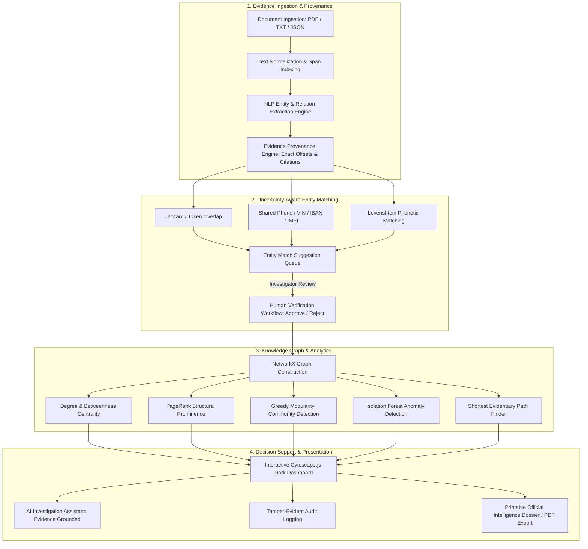

# AI-Powered Criminal Network Analysis System

An original, explainable, and secure investigative decision-support platform designed for authorized law enforcement analysts and prosecutors. The system ingests fragmented intelligence records, maintains complete evidence provenance, conducts uncertainty-aware entity resolution, detects cross-case relationships, analyzes network topology via NetworkX and Scikit-Learn, and surfaces explainable investigative insights while strictly enforcing the presumption of innocence.

---

## 1. System Architecture Overview



---

## 2. Core Distinctive Components

1. **Evidence Provenance Engine**: Every extracted entity and relationship retains a permanent pointer to its primary source document, character start/end offsets, page number, extraction confidence, and timestamp.
2. **Uncertainty-Aware Entity Matching**: Discovers possible duplicate entities and cross-case identities while explicitly calculating and presenting the mathematical reasons (token similarity, shared identifiers, aliases).
3. **Temporal Relationship Analysis**: Tracks how connections form over time across operational phases (Corporate Setup, Capital Deployment, Logistics Execution).
4. **Cross-Case Relationship Discovery**: Automatically identifies nexus entities (e.g. crypto wallets, burner phone SIMs, logistics vans) spanning multiple legally segregated cases.
5. **Explainable Network Analytics**: Calculates Degree Centrality, Betweenness Centrality, PageRank, and Modularity Clusters using NetworkX, paired with plain-language explanations of *why* an entity is highlighted.
6. **Human Verification Workflow**: AI extractions are strictly segregated under `PENDING_REVIEW` until an authorized officer explicitly approves or rejects the connection.
7. **Ethical Safeguard**: Includes automated disclaimers clarifying that topological centrality measures structural connectivity and **never implies guilt or legal liability**.
8. **Synthetic Data Lab & Scenario Engine**: Includes 4 pre-packaged realistic investigation scenarios (Maritime Port Bribery, Darknet Mixers, Cyber Extortion, and Master Mega-Network), 6 ready-to-extract evidence documents, 1-click dataset export (.JSON), and 1-click baseline resets.

---

## 3. Pre-Packaged Synthetic Investigation Scenarios

The system includes an integrated **Synthetic Data Lab** with multiple investigation profiles:

| Scenario Code | Operation Title | Focus & Key Anomalies |
| :--- | :--- | :--- |
| `BLUE_HORIZON` | **Operation Blue Horizon** | Maritime Port Infiltration, corrupt customs inspection codes, white Mercedes Sprinter dispatch, and $250k USDT escrow payment. |
| `ECLIPSE_NEXUS` | **Operation Eclipse Nexus** | Darknet vendor marketplace SilkRoad 4.0, Bitcoin ingestion, Tornado EVM privacy mixers, and Zurich private bank nominee off-ramps. |
| `COBALT_GHOST` | **Operation Cobalt Ghost** | Cyber extortion syndicate, command-and-control server leasing in Frankfurt, victim escrow deposits, and UK roaming burner lines. |
| `MASTER_COMPLEX` | **Master Mega-Network** | Unified 5-case super-network connecting maritime ports, shell company laundering, darknet mixing, and tactical fleet telemetry. |

---

## 3. Technology Stack

- **Backend**: Python 3.11, FastAPI, Pydantic v2, SQLAlchemy, Uvicorn
- **AI & Graph Analytics**: NetworkX, Scikit-learn (Isolation Forest), Heuristic & Regex NLP Token Span Engine, pypdfium2
- **Frontend**: React 18, Vite, TypeScript, Tailwind CSS, Cytoscape.js, Recharts, Lucide Icons
- **Database**: SQLite (built-in demonstration fallback) with zero-configuration initialization, fully compatible with PostgreSQL.
- **Security**: PyJWT (HMAC-SHA256), Passlib / Bcrypt password hashing, Role-Based Access Control (`ADMIN`, `INVESTIGATOR`, `ANALYST`), Tamper-evident Audit Logging.

---

## 4. Demonstration Accounts (Pre-Seeded)

| Username | Password | Role | Designation |
| :--- | :--- | :--- | :--- |
| `investigator` | `Investigator@2026!` | `INVESTIGATOR` | Special Agent Marcus Vance (Lead Investigator) |
| `admin` | `Admin@2026!` | `ADMIN` | Director Sarah Jenkins (Directorate Admin) |
| `analyst` | `Analyst@2026!` | `ANALYST` | Senior Analyst Elena Rostova (Graph Analytics) |

---

## 5. Quick Start Instructions

### Prerequisites
- Python 3.10+
- Node.js 18+ (Node 20 or 24 recommended)

### Step 1: Clone & Configure Environment
```bash
cp .env.example .env
```

### Step 2: Run Unified Server (Serves Backend & Pre-built SPA Frontend)
```bash
python -m uvicorn backend.main:app --host 0.0.0.0 --port 8000
```
Open **`http://localhost:8000`** in your browser. The single-page application and REST API endpoints will be live immediately!

### Step 3: (Optional) Frontend Development Server
If modifying frontend TypeScript source code:
```bash
cd frontend
npm run dev
```
Open **`http://localhost:5173`** with live hot-reloading connected via proxy to the backend on `:8000`.

---

## 6. Running the Automated Test Suite

A comprehensive test suite verifying authentication, NLP extraction, entity matching, graph metrics, human verification workflow, and AI citations is included.

```bash
python tests/test_units.py
```

### Verification Output Sample:
```
=================================================================
AI-POWERED CRIMINAL NETWORK SYSTEM - FULL VERIFICATION TEST
=================================================================
[OK] System Health: OPERATIONAL | DB Records: 3 Cases, 15 Entities, 15 Relationships
[OK] Auth Login: User 'investigator' (Role: INVESTIGATOR)
[OK] Dashboard Stats: 3 Cases, 15 Entities, 14 Verified Rels
[OK] Dashboard Charts: 7 Entity Types visualized
[OK] Case Management: 3 cases retrieved
[OK] Entity Management: 15 entities across 7 types
[OK] Human Verification Workflow: Successfully approved relationship
[OK] NLP Extraction Engine: 9 entities extracted, 5 relationships linked
[OK] Uncertainty-Aware Matching: Score 0.94 with reasons
[OK] Knowledge Graph: 15 Cytoscape nodes, 15 Cytoscape edges
[OK] Network Analytics:
     - Top Degree Hub: Dmitri Voronov (degree: 3)
     - Top Bridge (Betweenness): +31-6-555-0192 (score: 0.6264)
     - Community Clusters Found: 4
     - Explainable Anomalies Detected: 8
[OK] Shortest Path Finder: Path between #1 and #2 (Found: True, Hops: 1)
[OK] AI Assistant (Unverified query): 801 chars response
[OK] AI Assistant (Cross-case query): 869 chars response with 2 citations
[OK] Alerts & Audits: 3 alerts active, 13 tamper-evident audit records
=================================================================
ALL 13 VERIFICATION TESTS PASSED SUCCESSFULLY!
=================================================================
```

---

## 7. Algorithms & Methodological Documentation

| Component | Underlying Algorithm | Purpose & Explainability |
| :--- | :--- | :--- |
| **Hub Centrality** | Freeman's Degree Centrality | Measures direct connection volume to identify high-connectivity coordinators without inferring guilt. |
| **Bridge Centrality** | Brandes' Betweenness Centrality | Pinpoints gateway nodes linking disconnected operational cells. |
| **Structural Prominence** | PageRank (Brin & Page, 1998) | Weighs influence based on recursive links from other prominent entities. |
| **Community Clustering** | Clauset-Newman-Moore Greedy Modularity | Clusters nodes into functional criminal sub-cells. |
| **Outlier Detection** | Liu, Ting & Zhou's Isolation Forest | Scores topological outliers based on unusual combinations of degree, betweenness, and clustering coefficient. |
| **Entity Matching** | Levenshtein Distance & Token Jaccard | Computes uncertainty-aware similarity scores with explainable reasons. |
| **Shortest Evidentiary Path** | Dijkstra / BFS Shortest Path | Traces the minimum-hop evidentiary chain between any two investigative entities. |

---

## 8. Third-Party Libraries & Licenses

- **FastAPI** (MIT License) - High-performance Python web framework
- **SQLAlchemy** (MIT License) - Python SQL toolkit and Object Relational Mapper
- **NetworkX** (3-Clause BSD License) - Complex network analysis and graph metrics
- **Scikit-learn** (3-Clause BSD License) - Machine learning and anomaly detection
- **Cytoscape.js** (MIT License) - Graph theory library for network analysis and visualization
- **React.js & Vite** (MIT License) - Frontend rendering and build system
- **Tailwind CSS** (MIT License) - Utility-first CSS styling
- **Recharts** (MIT License) - Composable charting library built on React components
- **pypdfium2** (Apache 2.0 / BSD-3) - PDF text extraction engine
- **Lucide Icons** (ISC License) - Modern UI icons

---

## 9. Model Context Protocol (MCP) Server

The system includes a production-grade, zero-external-dependency **Model Context Protocol (MCP)** server (`mcp_server.py`) complying with the official Anthropic/Linux Foundation MCP specification (JSON-RPC 2.0 over stdio).

This allows any MCP-compliant AI client (such as Google Antigravity, Claude Desktop, Cursor, or custom agents) to interrogate the criminal network knowledge graph directly.

### Connecting to Antigravity
The workspace includes `.agents/mcp_config.json` and `mcp_config.json`:
```json
{
  "mcpServers": {
    "criminal-network-mcp": {
      "command": "python",
      "args": ["mcp_server.py"]
    }
  }
}
```

### Connecting to Claude Desktop (`claude_desktop_config.json`)
```json
{
  "mcpServers": {
    "criminal-network": {
      "command": "python",
      "args": ["c:/Users/Lenovo/OneDrive/Desktop/criminal network/mcp_server.py"]
    }
  }
}
```

### Exposed MCP Capabilities

#### 1. Investigative Tools (`tools/list`)
- `list_cases`: Query cases filtered by operational status (`ACTIVE`, `UNDER_REVIEW`, `CLOSED`, etc.).
- `search_entities`: Query persons, organizations, phone numbers, vehicles, financial accounts, or devices.
- `get_entity_dossier`: Comprehensive dossier with verified/unverified links and character-offset evidence provenance.
- `calculate_network_metrics`: Real-time Degree Centrality, Betweenness, PageRank, and community clusters.
- `find_shortest_evidentiary_path`: Multi-hop evidence chain between any two targets.
- `extract_intelligence_from_document`: NLP entity and relationship extraction on narrative dispatches.
- `get_pattern_alerts`: Unresolved structural network anomalies (e.g., cross-case bridges, money laundering cycles).
- `verify_relationship`: Human-in-the-loop verification, flagging, or dispute with chain-of-custody audit logging.

#### 2. Evidentiary Resources (`resources/list`)
- `investigation://cases` (Catalog of active operations)
- `investigation://network-graph` (Global graph topology statistics)
- `investigation://alerts` (Active pattern anomaly alerts)
- `investigation://audit-log` (Tamper-evident chain-of-custody audit trail)

#### 3. Structured Investigation Prompts (`prompts/list`)
- `investigate_person_of_interest`: Systematic dossier analysis and relationship verification.
- `cross_case_bridge_analysis`: Nexus discovery between two distinct criminal operations.
- `evidentiary_integrity_audit`: Automated check for unverified links and missing provenance offsets.

